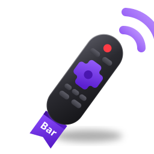
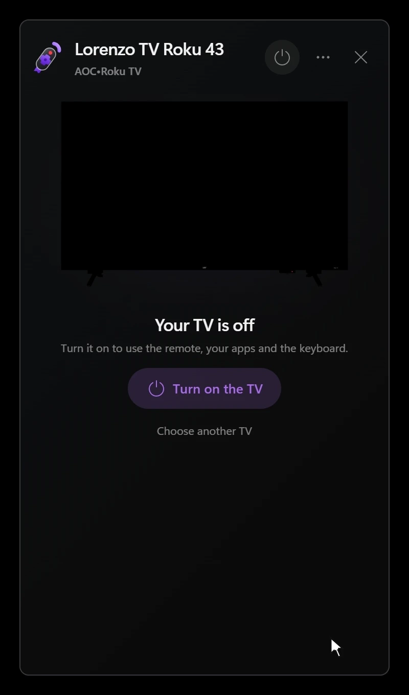

  

<h1 align="center">Rokubar</h1>

  
  
  
  
  

Rokubar is a Roku remote in the Windows tray. Its panel shows what the TV is doing, from the app on screen
to what plays and at what volume, and controls its keys, keyboard, apps, inputs, volume and power.

  

## How it works

Rokubar is built on top of [go-ssdp](https://github.com/lrnxzz/go-ssdp), which discovers the TVs on the
local network. The [`roku`](roku) package wraps Roku's
[External Control Protocol](https://developer.roku.com/docs/developer-program/dev-tools/external-control-api.md)
in a Go client built on [fasthttp](https://github.com/valyala/fasthttp), and the [`live`](live) package
uses that client to poll the paired TV every second, so Rokubar always knows its current state. The panel
is a [Wails](https://v3alpha.wails.io) window that talks to a local API built with
[Fiber](https://gofiber.io), which sends the commands to the TV and pushes every change of its state back
to the panel.

## Testing

Every test run starts [brs-node](https://github.com/lvcabral/brs-engine), a Roku simulator that answers
ECP and SSDP, in Docker, and holds the client, the polling and the API to what it answers. Rokubar is
also tested against a real TV, an `AOC 43S5155` running Roku OS 15.3.4, from Windows 11.

## Download

Run the `.exe` from the [latest release](https://github.com/lrnxzz/rokubar/releases/latest) and Rokubar
starts in the tray. It needs Windows 10 or 11 with WebView2.

## Credits

- [LGwebOS-menubar](https://github.com/gabrielgreco1/LGwebOS-menubar) by [Gabriel Greco](https://github.com/gabrielgreco1) - Inspiration for the panel's design
- [brs-node](https://github.com/lvcabral/brs-engine) by [Marcelo Lv Cabral](https://github.com/lvcabral) - The Roku simulator the tests run against
